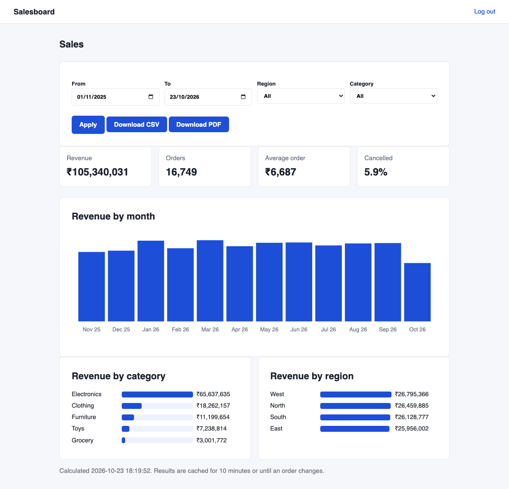
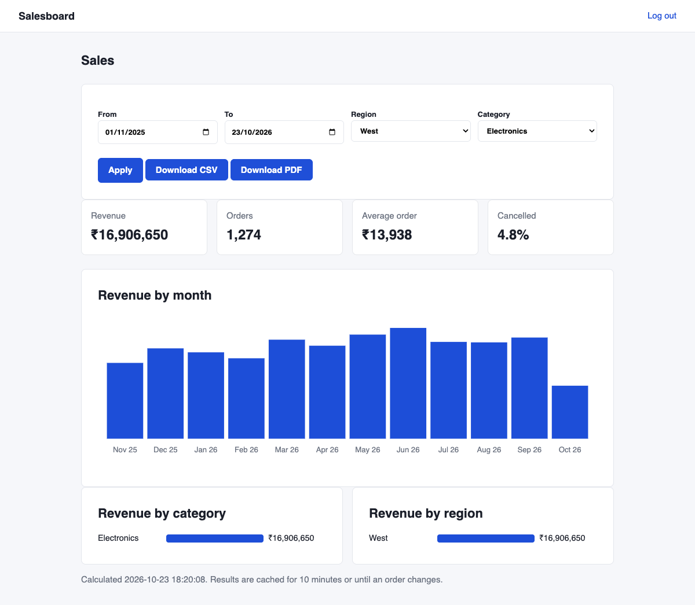

# Salesboard

A small sales reporting dashboard built with Laravel 12. It shows revenue, orders, average order value and cancellation rate for a date range, with a monthly chart and breakdowns by category and region. Reports can be filtered, downloaded as CSV (streamed, so large ranges don't use much memory) or as a PDF summary. It is a portfolio project with made-up data.



## What it does

- **Filters:** date range, region, category. Default is the last 12 months.
- **Numbers:** revenue (completed orders only), order count, average order value, cancelled share.
- **Charts:** monthly revenue as an SVG bar chart drawn in the Blade template, and bars for category and region. No JavaScript chart library. Months without sales show as empty bars rather than being skipped.
- **CSV export:** one row per order for the current filters, written in chunks of 1000 rows straight to the response.
- **PDF export:** a one-page summary of the same numbers (dompdf).
- **Caching:** the aggregate queries are cached for 10 minutes per filter combination and thrown away as soon as any order is created, changed or deleted.

On 20,000 seeded orders with MySQL 8.4 the dashboard queries take about 85 ms the first time and 0.3 ms from the cache.

| Filtered to West / Electronics |
|---|
|  |

## Running it

```bash
composer install
cp .env.example .env && php artisan key:generate
touch database/database.sqlite
php artisan migrate --seed     # 20,000 demo orders and one user
php artisan serve
```

Log in with `admin@example.com` / `password`. SQLite and MySQL both work; the one query that differs between them (grouping by month) is handled in `ReportService`.

## Tests

```bash
php artisan test
```

18 tests: totals and averages, empty ranges, empty months filled in, date range edges, filters, sorting, caching (a repeat request runs no queries, an order change makes the cache stale, expiry after 10 minutes), validation, login, CSV content and streaming over more than one chunk, and the PDF download.

For the design reasons, read [docs/HOW-IT-WORKS.md](docs/HOW-IT-WORKS.md).
